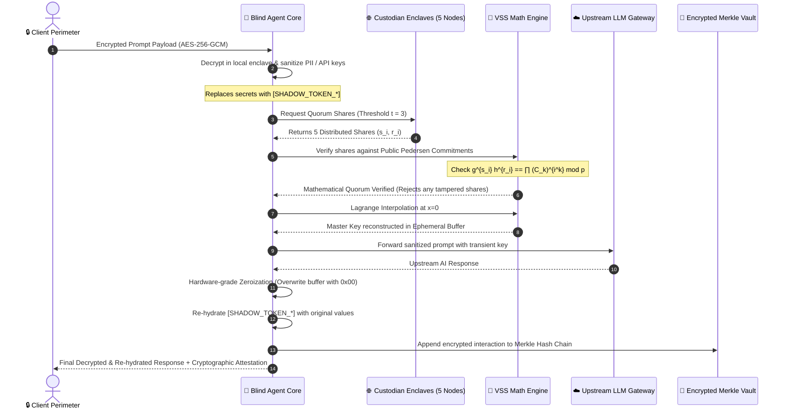

# AegisAgent 🛡️
### *Zero-Trust Cryptographic AI Agent & Verifiable Secret Sharing (VSS) Framework*

[](https://www.python.org/)
[](https://fastapi.tiangolo.com/)
[](https://www.rfc-editor.org/rfc/rfc3526)
[](tests/)
[](LICENSE)

---

## 📌 Executive Summary

**AegisAgent** is a state-of-the-art zero-trust cryptographic framework that enables AI agents to utilize highly sensitive credentials (master API keys, private keys, database connection strings) **without ever storing them in plaintext on disk, in databases, or exposing them in LLM telemetry logs**.

By uniting **$(t, n)$ Pedersen Verifiable Secret Sharing (VSS)** with **authenticated client-side encryption (AES-256-GCM)**, **zero-knowledge entity blinding**, and **ephemeral memory zeroization**, AegisAgent guarantees:
1. **No Single Point of Failure (SPOF)**: Master keys are sharded across $n$ independent custodian enclaves.
2. **Cheating Dealer & Corrupt Node Detection**: Participants mathematically verify their shares against homomorphic Pedersen commitments before reconstruction.
3. **Zero Upstream Leakage**: Cloud LLM providers receive only sanitized prompts containing cryptographic shadow tokens; credentials and PII are re-hydrated exclusively inside the local client boundary.
4. **Zero-Trace Memory Erasure**: Reconstructed secrets exist solely in volatile, hardware-isolated memory buffers for the exact microsecond duration of an API call, followed by explicit byte-level zeroization (`0x00`).

---

## 🏛️ System Architecture

The following diagram illustrates the complete zero-trust lifecycle of an interaction through AegisAgent:



---

## 🔬 Cryptographic Foundations

AegisAgent relies on robust, mathematically rigorous cryptographic primitives implemented with zero external mathematical dependencies over large finite fields.

### 1. Finite Field Arithmetic & Safe Prime Group
Computations take place over a multiplicative subgroup $\mathbb{G}_q \subset \mathbb{Z}_p^*$ generated by elements $g$ and $h$:
- **Safe Prime $p$**: 1536-bit MODP Safe Prime conforming to RFC 3526, where $p = 2q + 1$ and $q$ is a Sophie Germain prime.
- **Subgroup Order $q$**: Prime order ensuring discrete logarithm hardness.
- **Generators $g, h$**: Two verifiable generators of $\mathbb{G}_q$ such that $\log_g(h)$ is unknown (ensuring the discrete log relation is computationally intractable).

```
Prime P = 0xFFFFFFFFFFFFFFFFC90FDAA22168C234... (1536 bits)
Prime Q = (P - 1) / 2
Generator g = 2
Generator h = 3^2 mod p
```

---

### 2. Pedersen Verifiable Secret Sharing (VSS)
Unlike standard Shamir Secret Sharing—which is vulnerable to malicious dealers or corrupted participants passing fake shares—Pedersen VSS provides **information-theoretic privacy** and **computational binding**:

#### A. Sharing Phase (Dealer)
Given a secret $s \in \mathbb{Z}_q$, threshold $t$, and $n$ participants:
1. Select a random secret polynomial:
   $$f(x) = s + a_1 x + a_2 x^2 + \dots + a_{t-1} x^{t-1} \pmod q$$
2. Select an independent random blinding polynomial:
   $$f'(x) = r + b_1 x + b_2 x^2 + \dots + b_{t-1} x^{t-1} \pmod q$$
3. Publish public commitments $C_k$ for $k \in \{0, \dots, t-1\}$:
   $$C_k = g^{a_k} \cdot h^{b_k} \pmod p$$
4. Securely transmit share tuple $(s_i, r_i)$ to participant $i \in \{1, \dots, n\}$, where:
   $$s_i = f(i) \pmod q, \quad r_i = f'(i) \pmod q$$

#### B. Verification Phase (Participant)
Every participant independently verifies their share $(s_i, r_i)$ without disclosing it:
$$g^{s_i} \cdot h^{r_i} \equiv \prod_{k=0}^{t-1} \left(C_k\right)^{i^k} \pmod p$$
*If the equality holds, the share is mathematically guaranteed to lie on the committed polynomial; any tampering or dealer fraud is detected immediately.*

#### C. Reconstruction Phase (Lagrange Interpolation)
Given any subset of $t$ valid shares $\mathcal{S} = \{(x_i, s_i)\}_{i=1}^t$:
$$s = f(0) = \sum_{i \in \mathcal{S}} s_i \cdot \lambda_i(0) \pmod q$$
Where the Lagrange basis coefficient $\lambda_i(0)$ is:
$$\lambda_i(0) = \prod_{j \in \mathcal{S}, j \neq i} \frac{-j}{i - j} \pmod q$$

---

### 3. Feldman VSS (Alternative Mode)
AegisAgent also supports Feldman's scheme for lightweight verification:
- Public commitments: $C_k = g^{a_k} \pmod p$
- Verification equation: $g^{s_i} \equiv \prod_{k=0}^{t-1} (C_k)^{i^k} \pmod p$
- *Pedersen VSS offers information-theoretic hiding (unconditional secrecy even against unbounded adversaries), whereas Feldman offers computational hiding.*

---

### 4. Zero-Leakage Ephemeral Isolation & Hardware Zeroization
Reconstructed secret keys must never persist in memory or swap space:
- **`ephemeral_key_buffer`**: Allocates a mutable `bytearray` buffer within a scoped Python context manager.
- **Explicit In-Memory Zeroization**: Upon block exit or error, every byte of the buffer is explicitly overwritten with `0x00`, references are deleted, and garbage collection (`gc.collect()`) is triggered immediately.

---

## 🛠️ Key Features

| Feature | Description |
| :--- | :--- |
| **Pedersen & Feldman VSS** | Full mathematical implementations of both verifiable secret sharing protocols. |
| **Byzantine Fault Tolerance** | Detects and excludes corrupted/tampered custodian shares during quorum assembly. |
| **Zero-Knowledge Entity Blinding** | Automatically redacts API keys, credit cards, SSNs, emails, and financial amounts into shadow tokens. |
| **Ephemeral Key Lifecycle** | Transient credentials exist in RAM only for the duration of inference, followed by immediate zeroization. |
| **Tamper-Evident Memory Ledger** | Cryptographic Merkle hash chain records all agent actions with immutable audit proofs. |
| **Interactive Cyberpunk UI** | Glassmorphism dashboard featuring real-time node topology, interactive polynomial canvas, and live chat. |
| **OpenAPI / Swagger Compliant** | Fully typed FastAPI endpoints with Pydantic request/response validation. |

---

## 📂 Project Structure

```
Hackathon/
├── app/
│   ├── main.py                     # Application entrypoint & FastAPI server configuration
│   ├── agent/                      # Zero-Knowledge Blind Agent Subsystem
│   │   ├── blind_agent.py          # Pipeline: prompt blinding, quorum retrieval, zero-leakage execution
│   │   ├── custodian_network.py    # Custodian enclave cluster manager & Byzantine fault simulator
│   │   ├── llm_gateway.py          # Secure LLM gateway (OpenAI-compatible + built-in fallback)
│   │   └── memory_vault.py         # Encrypted memory ledger with Merkle tree integrity
│   ├── api/                        # REST API Layer
│   │   ├── models.py               # Pydantic schemas for requests and responses
│   │   ├── routes_agent.py         # Agent endpoints: chat, setup-key, custodians, fault injection
│   │   └── routes_vss.py           # VSS endpoints: split, verify, reconstruct
│   └── crypto/                     # Cryptographic Engine
│       ├── client_cipher.py        # Authenticated AES-256-GCM client encryption & HKDF
│       ├── feldman_vss.py          # Feldman Verifiable Secret Sharing implementation
│       ├── finite_field.py         # RFC 3526 1536-bit safe prime arithmetic & Lagrange engine
│       ├── pedersen_vss.py         # Pedersen VSS with information-theoretic commitments
│       └── zero_leakage.py         # Ephemeral memory isolation & byte-level zeroization
├── static/                         # Interactive Cyberpunk Web Dashboard
│   ├── index.html                  # Multi-tab single page application
│   ├── css/
│   │   └── style.css               # Glassmorphism design system & micro-animations
│   └── js/
│       ├── app.js                  # Application controller & state management
│       ├── node_topology.js        # Interactive SVG/Canvas custodian cluster visualizer
│       └── vss_visualizer.js       # Mathematical polynomial graph plotter
├── tests/                          # Automated Verification Suite
│   ├── test_blind_agent.py         # Tests for client cipher, entity sanitizer, & blind agent
│   └── test_vss.py                 # Tests for Pedersen/Feldman math, tampered shares, & quorum limits
├── LICENSE                         # MIT License
├── README.md                       # Comprehensive Project Documentation
└── requirements.txt                # Production dependencies
```

---

## 🚀 Quickstart & Setup Guide

### Prerequisites
- **Python 3.10+**
- **pip** package manager

### 1. Clone & Set Up Environment
```bash
# Clone the repository
git clone https://github.com/Shalinee1418/Hackathon.git
cd Hackathon

# Create and activate a virtual environment
python -m venv venv

# Windows (PowerShell):
.\venv\Scripts\Activate.ps1

# Linux / macOS:
source venv/bin/activate
```

### 2. Install Dependencies
```bash
pip install -r requirements.txt
```

### 3. Run the Automated Test Suite
Verify that all cryptographic formulas, Lagrange reconstructions, and agent pipelines are operating with 100% precision:
```bash
python -m unittest discover tests
```
*Expected Output:*
```
Ran 6 tests in 2.22s
OK
```

### 4. Start the Application Server
```bash
python -m app.main
```
Or with `uvicorn`:
```bash
uvicorn app.main:app --host 127.0.0.1 --port 8000 --reload
```

### 5. Access the Platform
- **Interactive Cyberpunk UI**: [http://127.0.0.1:8000](http://127.0.0.1:8000)
- **Interactive Swagger API Docs**: [http://127.0.0.1:8000/docs](http://127.0.0.1:8000/docs)
- **Alternative ReDoc Docs**: [http://127.0.0.1:8000/redoc](http://127.0.0.1:8000/redoc)

---

## 💻 Interactive Web Interface

The AegisAgent web client provides a unified console divided into four dedicated modules:

1. **🤖 AI Agent Enclave**:
   - Send encrypted messages to the blind agent.
   - Inspect the real-time execution timeline (decryption, entity masking, share gathering, VSS proof verification, zero-leakage inference, and re-hydration).
   - View intercepted shadow tokens and cryptographic attestation receipts.

2. **📐 VSS Math Lab**:
   - Split arbitrary text keys or numbers into $(t, n)$ shares using Pedersen or Feldman schemes.
   - Real-time 2D curve rendering of the secret polynomial $f(x)$.
   - Independent share verification tool verifying that $g^s h^r \equiv \prod C_k^{i^k} \pmod p$.

3. **🌐 Custodian Network**:
   - Interactive visual map of the 5 distributed enclaves (`Guardian-Alpha`, `Sentinel-Beta`, `Vault-Gamma`, `Cipher-Delta`, `Echo-Epsilon`).
   - **Byzantine Fault Injection**: Click "Tamper Node" to inject corrupted bitflips into a custodian and watch the VSS engine catch and reject the corrupted node during quorum reconstruction.

4. **📜 Cryptographic Proofs**:
   - Tamper-evident Merkle hash chain inspector displaying block hashes, previous block linkages, and root state.

---

## 📡 API Reference

### 🔐 Verifiable Secret Sharing Endpoints (`/api/vss`)

#### `POST /api/vss/split`
Splits a secret string or integer into verifiable shares.
```json
{
  "secret": "sk-production-master-secret-token-99",
  "threshold": 3,
  "num_participants": 5,
  "scheme": "pedersen"
}
```
**Response:**
```json
{
  "status": "SUCCESS",
  "scheme": "Pedersen VSS",
  "threshold": 3,
  "num_participants": 5,
  "commitments_hex": ["0xabc123...", "0xdef456...", "0x789aaa..."],
  "shares": [
    {
      "index": 1,
      "secret_share_hex": "0x12a...",
      "blinder_share_hex": "0x45b...",
      "custodian_name": "Node-01"
    }
  ],
  "prime_p_hex": "0xffffff...",
  "order_q_hex": "0x7fffff..."
}
```

#### `POST /api/vss/verify`
Mathematically verifies an individual share against the public commitments without revealing the secret.
```json
{
  "index": 1,
  "secret_share_hex": "0x12a...",
  "blinder_share_hex": "0x45b...",
  "commitments_hex": ["0xabc123...", "0xdef456...", "0x789aaa..."],
  "scheme": "pedersen"
}
```

#### `POST /api/vss/reconstruct`
Reconstructs the original secret using any $t$ verified shares via Lagrange interpolation.
```json
{
  "shares": [ ... ],
  "commitments_hex": [ ... ],
  "threshold": 3,
  "scheme": "pedersen"
}
```

---

### 🤖 Private AI Agent Endpoints (`/api/agent`)

#### `POST /api/agent/setup-key`
Shards a master credential across the custodian enclaves.
```json
{
  "master_key": "sk-live-prod-secret-42",
  "threshold": 3,
  "num_nodes": 5
}
```

#### `POST /api/agent/chat`
Dispatches a query to the blind agent. The request can contain plaintext (which will be encrypted locally) or a pre-encrypted AES-256-GCM envelope.
```json
{
  "prompt": "Audit customer record: patient John Doe, SSN 000-12-3456, account balance $45,000.",
  "client_tag": "Client-Enclave-01"
}
```
**Response includes:**
- `receipt`: Unique cryptographic receipt with timestamp, prompt hashes, and Merkle root.
- `sanitized_prompt`: Blinded prompt seen by the upstream provider.
- `timeline`: Step-by-step audit timings for decryption, sanitization, VSS verification, and zeroization.
- `final_response`: Fully re-hydrated response restored inside client perimeter.

#### `GET /api/agent/custodians`
Returns the status, regions, and active share integrity of all custodian nodes.

#### `POST /api/agent/custodian/tamper`
Simulates Byzantine failure by corrupting the share bits of a designated node.
```json
{
  "node_id": 2
}
```

#### `POST /api/agent/custodian/restore`
Restores a compromised custodian node back to a verified valid state.

---

## 🔒 Threat Model & Security Guarantees

| Threat | Traditional Setup | AegisAgent Guarantee |
| :--- | :--- | :--- |
| **Compromised Custodian Node** | Single stolen key compromises the entire infrastructure. | Adversary must simultaneously compromise $t$ enclaves. Unopened shares reveal 0 bits of information. |
| **Malicious Dealer** | Dealer can distribute inconsistent shares, creating consensus forks. | Homomorphic Pedersen commitments guarantee all participants hold shares of the same polynomial. |
| **Corrupted / Byzantine Node** | Node submits forged share during reconstruction, corrupting key. | Share verification equation ($g^s h^r == \prod C_k^{i^k}$) rejects forged shares prior to interpolation. |
| **RAM / Memory Dumps** | Master credentials persist indefinitely in process memory and swap space. | Ephemeral buffers are explicitly overwritten with `0x00` immediately following inference. |
| **LLM Provider Logging** | Upstream AI providers capture and log sensitive API keys and PII. | Entity Sanitizer replaces all sensitive data with shadow tokens before requests leave the boundary. |

---

## 🧪 Testing Matrix

The automated test suite in [`tests/`](tests/) rigorously validates:
1. **Honest Dealer Protocol**: Verifies that standard Pedersen and Feldman distributions pass all homomorphic checks.
2. **Lagrange Reconstruction**: Validates exact algebraic reconstruction of string and integer secrets for any permutation of $t$ shares.
3. **Malicious Tamper Detection**: Injects random bitflips into shares and ensures the verification engine detects and flags `FRAUD DETECTED`.
4. **Quorum Boundaries**: Asserts that subsets containing fewer than $t$ valid shares fail with explicit quorum error messages.
5. **Authenticated Client Cipher**: Verifies that AES-256-GCM payloads reject any ciphertext modifications or invalid nonces.
6. **Entity Sanitizer & Shadow Token Re-hydration**: Confirms that sensitive patterns (keys, emails, financial amounts) are masked upstream and restored downstream.

---

## 📜 License

This project is licensed under the **MIT License** - see the [LICENSE](LICENSE) file for details.
